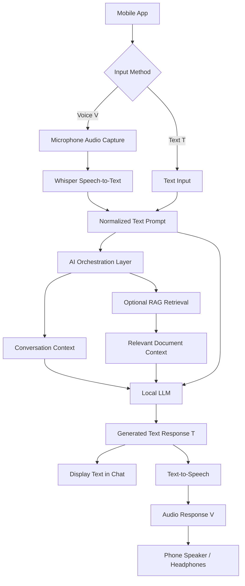

# YouAI — Voice-Based AI Assistant

YouAI is a voice-first AI assistant designed for a mobile application. It aims to let users talk naturally with an AI, receive spoken answers, and use text whenever they prefer. The proposed design prioritizes a local LLM, with optional Retrieval-Augmented Generation (RAG) for answers grounded in personal documents or a custom knowledge base.

> **Project status:** This README describes the proposed architecture and workflow. Individual components may still need to be implemented and integrated.

## Core Features

- **Voice interaction:** Speak to the assistant and hear its response.
- **Text interaction:** Type a prompt and receive a text answer.
- **Voice/text conversion:** Voice input is transcribed to text (V → T); generated text can be spoken aloud (T → V).
- **Local LLM:** Run a compatible language model locally where the target device's hardware allows it.
- **RAG support:** Retrieve relevant information from local documents or a knowledge base before generating an answer.
- **Conversation flow:** Keep the interaction in one chat interface, with clear listening, processing, and speaking states.
- **Privacy-focused design:** Prefer on-device processing for supported features; clearly indicate when a network or remote service is required.

## System Architecture

### Component Responsibilities

| Component | Responsibility | Possible implementation |
|---|---|---|
| Mobile UI | Chat screen, text field, microphone button, playback controls and status indicators | Flutter for Android/iOS; native UI is also possible |
| Audio capture | Record microphone input and manage permissions | Platform audio APIs or a Flutter audio plugin |
| Speech-to-text | Convert spoken audio (V) into text (T) | Whisper or whisper.cpp |
| AI orchestration | Route prompts, attach conversation context, and coordinate model and retrieval calls | In-app service layer or a local API |
| Local LLM | Generate a response from the user's prompt and relevant context | A compatible quantized Gemma or Qwen model, using a suitable runtime such as llama.cpp |
| RAG (optional) | Find relevant passages in local documents and provide them as context to the LLM | Embedding model plus local vector index, such as FAISS where supported, or a SQLite-based retrieval design |
| Text-to-speech | Convert generated text into spoken audio (T → V) | Native Android/iOS TTS or a compatible local TTS engine such as Piper |
| Conversation storage | Save chat messages and user preferences | SQLite or another local database |

These are technology options, not claims that every option is already integrated. Choose runtimes and model variants based on the target platform, model licence, memory usage, latency, and supported hardware.

## Voice Button State Flow

The primary voice button should communicate what the assistant is doing at every step.

1. **Idle:** Ready for text or voice input.
2. **Recording / Listening:** The button changes to a listening state and microphone audio is captured.
3. **Transcribing:** Speech-to-text converts voice (V) to text (T).
4. **Thinking:** The app sends the text to the AI orchestration layer; optional RAG retrieval supplies relevant context before LLM inference.
5. **Speaking:** The response text is displayed and passed to text-to-speech.
6. **Finished:** Playback ends and the app returns to idle.

Users should be able to stop recording, replay audio, and interrupt speech playback. Handle microphone permission denial, empty audio, transcription errors, model loading failures, and unavailable network services gracefully.

## End-to-End Workflow

### Voice input (V → T)

1. The user taps the microphone button and speaks.
2. The app captures audio with the appropriate microphone permissions.
3. Whisper transcribes the audio into text.
4. The app displays the recognized text and sends it to the AI orchestration layer.

### AI response

1. The orchestration layer combines the prompt with the conversation context.
2. If RAG is enabled and relevant, it searches the configured knowledge base for supporting passages.
3. The local LLM generates an answer using the prompt and retrieved context.
4. The app displays the generated answer as text.

### Spoken output (T → V)

1. The generated text is passed to a text-to-speech engine.
2. The app plays the resulting audio through the phone speaker or headphones.
3. Playback status is shown in the UI, and the user can stop or interrupt it.

## Deployment Options

### Option A: Fully on-device

The speech recognizer, LLM, retrieval system, storage, and TTS all run on the phone where compatible implementations are available.

**Advantages:** Better offline capability and data locality.

**Trade-offs:** Model size, RAM, battery use, device compatibility, and response latency must be tested. “Local LLM” alone does not guarantee that every component works offline.

### Option B: Phone + local computer

The phone provides the interface while a local computer runs the LLM and other heavier components behind a local API.

**Advantages:** Easier early development and access to larger models.

**Trade-offs:** The phone generally needs to reach the computer over the same network, and the server must be running.

### Option C: Hybrid

Use on-device components when available and an explicitly configured remote service as an optional fallback. Clearly communicate when data leaves the device and never expose API keys in the mobile client.

## Suggested Development Phases

1. Build the mobile chat UI and voice-button state machine.
2. Implement microphone capture, permissions, and voice-to-text transcription.
3. Connect a small local LLM and display text responses.
4. Add text-to-speech and playback controls.
5. Add conversation history and local storage.
6. Integrate RAG for selected documents and display sources when possible.
7. Test latency, accuracy, offline behaviour, battery use, privacy, and error handling on target devices.

## Design Principles

- Keep voice and text input on the same conversation pipeline.
- Treat RAG as an optional retrieval step, not a replacement for the LLM.
- Do not describe the assistant as fully offline until every required component has been verified offline.
- Make recording and playback states visible and provide easy stop controls.
- Evaluate speech recognition and answer quality across the languages and accents the app intends to support.
- Select models only after checking device requirements and model licences.

## Future Scope

- Multilingual voice conversations.
- Wake-word activation, only with clear consent and battery/privacy testing.
- User-controlled memory and searchable conversation history.
- Importing PDFs and other documents into a RAG knowledge base.
- Streaming responses and low-latency speech playback.
- Configurable voice, speaking speed, and interruption behaviour.
