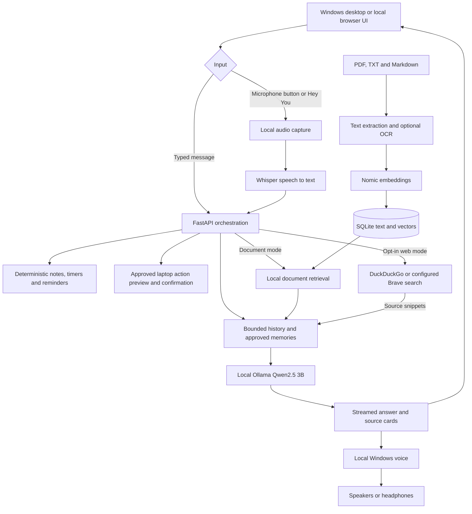

# YouAI — Local Voice Assistant for Windows

YouAI is a local-first personal assistant with a simple circular microphone button. Click it or enable **“Hey You”**, speak naturally, and receive a spoken response. You can also type, ask questions about your documents, save approved memories, set reminders, and perform a small set of approved laptop actions.

**Version 0.4.0 · Windows preview · Status updated 17 October 2026**

The working implementation runs on a Windows laptop. Android development is paused, iOS is not implemented, and public cloud deployment is not configured. This is a functional preview with documented test limits, not a production-ready hosted service.

## Project status

Implemented:

- Local voice and text conversations with streamed answers, sentence-by-sentence playback, cancellation and replay.
- Opt-in “Hey You” detection, wake sensitivity, pause duration, language settings and spoken interruption.
- Installed Windows voices, preferring Microsoft Zira or Heera when available; voice selection and speaking-rate controls.
- Persistent conversation history, searchable notes, timers and reminders.
- Personal memory saved only after explicit approval, with view/edit/delete controls.
- Local document RAG: PDF, TXT and Markdown import, searchable library, document selection and inspectable source passages.
- Summaries that process every indexed passage in groups, then combine the section summaries.
- Local scanned-PDF OCR in English, Hindi, Spanish, French and German.
- Approved folder indexing, filename search, application launching and creation of new text/Markdown files.
- Electron desktop window, tray icon, optional startup with Windows, **Ctrl+Alt+Space**, and native reminder notifications.
- Free opt-in DuckDuckGo search without an account or API key; optional Brave integration.
- Windows installer containing the backend source and interface, with first-run dependency and model setup.

Validation completed:

- **35 Python tests + 15 browser tests passed.**
- Live free search, local-model answers, hierarchical summaries and scanned-page OCR in all five languages were exercised.
- Five synthetic wake recordings passed; the local transcription/RAG/generation pipeline passed with outbound Python sockets blocked.
- Automated installer execution and the installed desktop app were tested using a separately provisioned backend environment.
- The user confirmed wake detection, voice playback, spoken interruption and visible Windows reminder delivery.

Still awaiting hands-on validation:

- Background wake detection while minimized to the desktop tray.
- Reminder delivery across a real Windows sleep/resume cycle.
- The interactive installation wizard and a pristine Windows computer with Python and Ollama absent. The automatic download branches exist, but the installation test reused existing runtimes.
- Broader testing across accents, noise, hardware and languages.

The installer is **unsigned**. See [release checks](RELEASE_CHECKS.md) for the evidence and remaining checks, and [desktop behavior and limits](DESKTOP.md) for detailed feature documentation.

## Which AI models does it use?

**The default conversational model is Qwen2.5 3B, running locally through Ollama as `qwen2.5:3b`.** There is no Claude or cloud chat API in the default conversation pipeline.

- **Conversation:** `qwen2.5:3b` generates answers through Ollama on `127.0.0.1:11434`.
- **Document embeddings:** `nomic-embed-text` through Ollama converts document passages and questions into vectors for retrieval.
- **Speech recognition:** Whisper **base**, executed with `faster-whisper` on the CPU using int8 computation.
- **Wake detection:** Vosk `vosk-model-small-en-us-0.15`, using a constrained “hey you” phrase grammar. This is a streaming phrase recognizer, not a custom-trained wake-word neural model.
- **Spoken replies:** installed local Windows voices. The desktop client uses `System.Speech`; the browser uses local Web Speech voices. No separate generative voice model is bundled.
- **OCR:** Tesseract language data via PyMuPDF for scanned PDF pages.

You can change the installed Ollama conversation model using `YOUAI_MODEL`. Model quality, latency and memory use depend on the chosen model and your hardware. Model weights retain their own licenses; see [third-party notices](THIRD_PARTY_NOTICES.md).

## How it works



1. The microphone button or opt-in wake listener starts a voice request. Audio is processed locally; typing joins the same conversation pipeline.
2. Whisper transcribes the request. FastAPI routes supported note/reminder commands deterministically, rather than asking the LLM to pretend to execute them.
3. For conversation, the backend adds bounded history and explicitly approved memories. Document mode adds retrieved passages; web mode adds search snippets.
4. Ollama generates the answer locally. Text streams to the interface, and complete sentences can be spoken before generation finishes.
5. You can stop an answer or interrupt spoken playback. Completed conversations are saved locally; failed/cancelled partial answers are not saved as completed turns.

Laptop actions use a separate permission and confirmation flow. The language model cannot execute arbitrary shell commands or directly control your computer.

### What RAG does

Retrieval-Augmented Generation supplies relevant document text to the existing model; it does **not** train or fine-tune Qwen on your files.

Imported text is split into overlapping passages, embedded using Nomic, and stored with its vectors in SQLite. Questions are embedded and compared with the stored vectors using cosine similarity. The most relevant passages are supplied to Qwen, and the interface displays the supporting excerpts. You can restrict questions to selected documents.

Summaries use a separate flow that reads **all indexed passages**, summarizes bounded groups, and combines those summaries. They still condense details and cannot recover content missed during extraction or OCR. Long documents take longer to process.

Document limits: 10 MB per file, 150 PDF pages, 300,000 extracted characters, 400 passages per document and 4,000 passages across the index. Changing the embedding model requires rebuilding the index.

## Run from source on Windows

### Prerequisites

- A 64-bit Windows computer with a microphone and local playback voice.
- Git and Python; the development environment was tested with **Python 3.14.7**.
- [Ollama for Windows](https://ollama.com/download/windows), installed for your Windows account. The source setup script expects its standard per-user installation path.
- Node.js and npm for the Electron desktop client, packaging and browser tests; development was tested with Node.js 24.
- Internet for the first dependency/model downloads and several GB of available disk space. Actual memory and performance requirements depend on the models and hardware.

### Set up and open the browser interface

Run in PowerShell:

```powershell
git clone https://github.com/Armaan-30/YouAI.git
cd YouAI
powershell -NoProfile -ExecutionPolicy Bypass -File .\setup.ps1
powershell -NoProfile -ExecutionPolicy Bypass -File .\start.ps1
```

Setup creates `.venv`, installs Python dependencies, and downloads the chat, embedding, speech, wake and OCR assets. The app opens at **http://127.0.0.1:8765**. Allow microphone access when prompted.

To stop the source backend:

```powershell
powershell -NoProfile -ExecutionPolicy Bypass -File .\stop.ps1
```

Ollama runs separately and has its own lifecycle.

### Open the Windows desktop client

After source setup:

```powershell
npm ci
npm run desktop
```

The desktop client starts the local backend and Ollama when needed. Closing its window leaves it in the tray; choose **Quit YouAI** to exit. **Ctrl+Alt+Space** opens the window and starts listening. Enable background wake listening explicitly if you want the microphone to remain active while minimized.

### Build the installer

```powershell
npm ci
npm run package:windows
```

Output: `dist/YouAI Setup 0.4.0.exe`.

The installer includes the interface and backend source. First launch reuses supported local runtimes or downloads Python/Ollama, installs dependencies, and downloads models. A setup window shows progress; restarting retries an incomplete setup. The first-run setup is not an offline bundle of model weights.

**Generated installers are excluded from Git.** Cloning this repository does not download an installer or any AI model weights. No GitHub release upload is performed by these commands.

## Try these tasks

- “Hey You, what can you do?”
- “Save a note: my next idea is a voice journal.”
- “Show my notes.”
- “Find notes about groceries.”
- “Remind me in 10 minutes to drink water.”
- “Set a timer for 5 minutes.”
- “Remember that I prefer short answers.” Then review and approve the proposed memory.
- Import a document in **Conversation**, enable **Answer from my documents**, and ask about it.
- Select **Summarize** next to a document to summarize all indexed passages.
- Enable **Search the web** for an online question; source links appear with the answer.

Under **Laptop actions**, explicitly approve an `.exe` or folder. Opening apps and creating files require a separate preview and confirmation. New files are limited to `.txt` and `.md`; existing files are not overwritten. Folder searches stay within approved locations. Auto-indexing scans approved folders periodically; deleting a source file does not automatically delete its indexed copy.

## Privacy, storage and internet use

Default locations:

- **Qwen and embedding weights:** `%USERPROFILE%\.ollama\models`, unless Ollama is configured differently.
- **Conversation, memories, notes, reminders and document index:** `%LOCALAPPDATA%\YouAI\youai.sqlite3`.
- **Whisper, Vosk and OCR assets:** `%LOCALAPPDATA%\YouAI\models`.
- **Source-run logs:** `.runtime/` inside the checkout.
- **Installed desktop runtime/setup log:** the `runtime` folder under Electron's user-data directory, normally `%APPDATA%\youai`.

Model weights, databases, `.env` files, environments, generated installers and pairing credentials are excluded from Git. Audio is processed in memory and is not saved by the app. Deleting a memory removes it from future memory context, but old conversation messages remain until you clear them. Removing a document does not erase excerpts already saved in conversation history.

Once dependencies and models are installed, ordinary chat, transcription, RAG and local voice playback use local components. The Python pipeline was checked with outbound sockets blocked; this is **not** a system-wide airplane-mode certification.

Web search is off by default. When enabled, only the current question is sent to the configured search service; stored history, memories and document contents are not sent to it. DuckDuckGo search uses the unofficial DDGS integration and can be unavailable or rate limited. Results are snippets, not full web pages. Brave is optional and requires your own API configuration. There is no automatic cloud LLM fallback.

Reminders need the app running and the laptop awake for timely delivery. The app does not wake a sleeping computer or deliver alarms while powered off. Windows notification settings can affect visibility.

## Configuration

Set environment variables before setup/start and restart the backend after changing them. `.env` files are ignored by Git but are **not automatically loaded**.

- `YOUAI_MODEL`: Ollama chat model; default `qwen2.5:3b`.
- `YOUAI_WHISPER_MODEL`: Whisper size; default `base`. Set before setup to download that size.
- `YOUAI_EMBED_MODEL`: embedding model; default `nomic-embed-text`. Download a custom model manually and re-import documents after changing it; setup pulls the default.
- `YOUAI_DATA_DIR`: alternative database and speech/wake data directory.
- `YOUAI_TIMEZONE`: reminder time zone; default `Asia/Kolkata`.
- `YOUAI_PRELOAD=0`: disable startup model preloading.
- `YOUAI_OCR_LANGUAGES`: OCR languages for folder indexing, such as `eng+hin`. Manual imports have their own language selector.
- `YOUAI_TESSDATA`: alternative OCR language-data directory; its default is `%LOCALAPPDATA%\YouAI\models\tessdata`.
- `YOUAI_SEARCH_PROVIDER`: `duckduckgo` by default, or `brave`.
- `YOUAI_BRAVE_KEY`: required only for Brave; keep it out of source control.

For example, to select another already installed chat model for the current PowerShell session:

```powershell
$env:YOUAI_MODEL = 'your-installed-ollama-model'
.\start.ps1
```

## Tests and validation

After source setup and `npm ci`:

```powershell
.\.venv\Scripts\python.exe -m unittest discover -s tests -q
npx playwright install chromium
npm test
```

Additional checks have specific prerequisites:

```powershell
# Internet + running Ollama: free search and real-model summary
.\.venv\Scripts\python.exe scripts/check_release.py

# Installed OCR data + Windows Nirmala font: image-PDF language checks
.\.venv\Scripts\python.exe scripts/check_ocr_languages.py

# Build the Windows app first: executable, tray, shortcut and real test notification
node scripts/smoke_desktop.cjs
```

`scripts/measure_voice.py` and `scripts/check_local_pipeline.py` use local synthetic WAV fixtures under `.runtime`; those generated fixtures are not in Git. They need to be provided before running those optional checks on a new checkout. Desktop notification checks can display a test notification.

See [RELEASE_CHECKS.md](RELEASE_CHECKS.md) for the current results and unverified scenarios.

## Repository layout

- `app/`: FastAPI backend, speech/wake adapters, tasks, memory, SQLite storage, RAG, summaries and optional search.
- `web/`: microphone-button interface, audio capture, streaming playback and settings.
- `desktop/`: Electron window, preload bridge, tray, Windows speech and first-run setup.
- `scripts/`: dependency/model setup, packaging and live validation helpers.
- `tests/`: Python and Playwright tests.
- `android/` and phone scripts: retained experimental Android client and paired LAN access; development is paused.
- [WINDOWS.md](WINDOWS.md): source-run Windows guide.
- [DESKTOP.md](DESKTOP.md): desktop features, permissions and limits.
- [ANDROID.md](ANDROID.md): paused Android experiment.
- `youai-ios-roadmap.html`: historical planning document from before implementation; it does not represent current status.

## Deployment and future work

The supported target is a **single-user Windows assistant backed by the user's laptop**. A GitHub push publishes source code; it does not publish a running assistant or upload the models.

Uploading this code to Render or Vercel does not create a working public multi-user service. That would require hosted inference, authentication, per-user data isolation, persistent cloud storage, resource limits and a web-compatible alternative to Windows-only actions. These are not implemented. Android is paused and there is no working iOS application.

Near-term work is the remaining background-wake, sleep/resume and clean-machine acceptance testing. Other possible extensions include broader document/language testing, improved wake accuracy and additional explicitly approved task integrations. Calendar, email sending and unrestricted computer control are not currently supported.

## License

YouAI's own source is under the [MIT License](LICENSE). Dependencies and model weights have separate terms. In particular, PyMuPDF uses AGPL/commercial licensing and Qwen2.5-3B has its own model license. Read [THIRD_PARTY_NOTICES.md](THIRD_PARTY_NOTICES.md) before redistributing a combined application or operating a hosted service.
